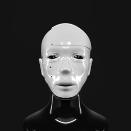
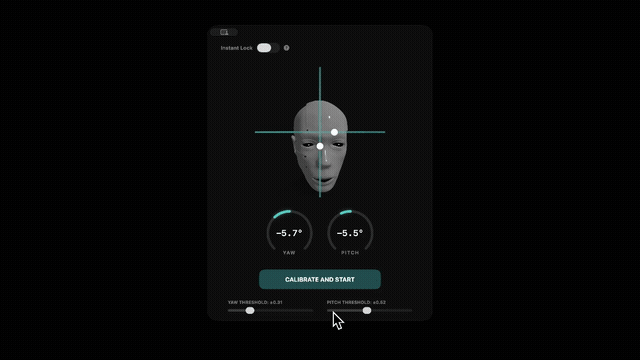
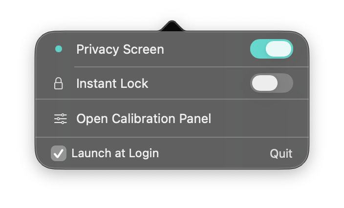
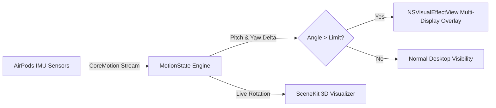

<p align="center">
  
</p>

<h1 align="center">PrivacyScreen</h1>

<p align="center">
  <strong>Intelligent head-tracking privacy shield for macOS using Apple CoreMotion and AirPods.</strong>
</p>

<p align="center">
  <a href="https://github.com/qn34uc59t/privacy_screen/releases"></a>
  
  
  <a href="LICENSE"></a>
</p>

---

## What is PrivacyScreen?

**PrivacyScreen** is a lightweight, zero-latency macOS menu bar application that automatically conceals your active displays behind a frosted privacy blur the moment you turn your head away from your screen.

By tapping into the high-frequency IMU motion sensors in your Apple AirPods or compatible Beats headphones via Apple's native `CMHeadphoneMotionManager`, PrivacyScreen monitors your yaw and pitch angles in real time without ever turning on a camera, recording your screen, or transmitting a single byte over the network.

---

## Demo

<p align="center">
  
</p>
<p align="center">
  <em>Live head-tracking glance detection shielding the display. (<a href="assets/1.mp4">HD Video Walkthrough</a>)</em>
</p>

<br />

<p align="center">
  
</p>
<p align="center">
  <em>Compact macOS Menu Bar popover with Instant Lock, status indicator, and calibration controls.</em>
</p>

---

## Key Features

- **Head-Tracking Glance Detection:** Real-time angular delta calculation (yaw & pitch) via Apple `CMHeadphoneMotionManager`.
- **Zero-Latency Display Shield:** Instantly overlays all connected screens with an Apple-native `NSVisualEffectView` frosted glass material (`.fullScreenUI`).
- **3D Real-Time Head Visualizer:** Interactive SceneKit 3D head model showing your live orientation and calibration baseline.
- **Hysteresis & Anti-Flicker:** Dual-threshold triggers ensure screen blurring does not flicker during subtle head shifts.
- **Instant Lock / Paranoia Mode:** Optionally lock your macOS user session immediately upon trigger rather than only blurring the screen.
- **Multi-Monitor Support:** Automatically creates and aligns overlay windows across all active `NSScreen` displays.
- **Launch at Login:** Integrated with macOS `SMAppService` for seamless boot launch.
- **Zero Surveillance Architecture:** Does not require camera permissions, does not record the screen, and makes zero network requests.

---

## Hardware Compatibility

PrivacyScreen requires Apple headphones equipped with spatial motion gyroscopes and accelerometers:

| Device | Supported | Notes |
| :--- | :---: | :--- |
| **AirPods Pro (2nd Generation)** | ✅ Yes | Full 6-DoF headphone motion tracking |
| **AirPods Pro (1st Generation)** | ✅ Yes | Full 6-DoF headphone motion tracking |
| **AirPods Max** | ✅ Yes | Full 6-DoF headphone motion tracking |
| **AirPods (3rd Generation)** | ✅ Yes | Full 6-DoF headphone motion tracking |
| **Beats Fit Pro** | ✅ Yes | Full 6-DoF headphone motion tracking |
| **Standard AirPods (1st & 2nd Gen)** | ❌ No | Missing IMU spatial motion sensors |
| **Non-Apple Bluetooth Headphones** | ❌ No | Apple CoreMotion requires Apple H1/H2 chip |

---

## Security & Privacy Guarantee

PrivacyScreen is built with privacy-first engineering:

- **No Camera Required:** Unlike camera-based eye-tracking solutions, your web camera is never accessed or requested.
- **No Screen Capture:** PrivacyScreen creates an overlay window in front of your desktop. It does not inspect, read, or record screen contents.
- **No Network Requests:** No analytics, no telemetry, no remote servers. All computation executes locally on your CPU/GPU.
- **Privacy Manifest:** Shipped with a standard Apple Privacy Manifest (`PrivacyInfo.xcprivacy`) declaring zero tracking and zero data collection.

---

## Installation

### Method 1: Homebrew (Recommended)

```bash
brew install --cask qn34uc59t/tap/privacyscreen
```

Quarantine flags are automatically cleared during install. Updates via `brew upgrade privacyscreen`.

### Method 2: Download Pre-built DMG

1. Download `PrivacyScreen-v1.0.dmg` from [GitHub Releases](https://github.com/qn34uc59t/privacy_screen/releases).
2. Open the disk image and drag **PrivacyScreen** to your `/Applications` folder.
3. Clear the macOS Gatekeeper quarantine flag before first launch:
   ```bash
   xattr -cr /Applications/PrivacyScreen.app
   ```
4. Launch **PrivacyScreen** from Spotlight or `/Applications`.

### Method 3: Build from Source

```bash
# 1. Clone repository
git clone https://github.com/qn34uc59t/privacy_screen.git
cd privacy_screen

# 2. Build Release DMG using included packaging script
./scripts/package-dmg.sh 1.0

# 3. Mount and run
open dist/PrivacyScreen-v1.0.dmg
```

Or open `PrivacyScreen.xcodeproj` in Xcode 15+ and run directly (`Cmd+R`).

---

## How It Works



1. **Sensor Ingestion:** `CMHeadphoneMotionManager.startDeviceMotionUpdates(to: .main)` streams rotation matrix and attitude angles.
2. **Baseline Calibration:** Captures user's natural center gaze baseline:
   $$\Delta \text{yaw} = \text{yaw} - \text{baseline}_{\text{yaw}}$$
   $$\Delta \text{pitch} = \text{pitch} - \text{baseline}_{\text{pitch}}$$
3. **Threshold Assessment:** Triggers privacy overlay when $|\Delta\text{yaw}| > \theta_{\text{yaw}}$ or $|\Delta\text{pitch}| > \theta_{\text{pitch}}$.
4. **Hysteresis Recovery:** Requires user head orientation to return within safe margin before clearing the overlay, preventing oscillation.

---

## Development & Automation

- **Automated CI:** Every push and pull request is verified via GitHub Actions (`.github/workflows/ci.yml`).
- **Automated Packaging:** Pushing a version tag (e.g. `v1.0`) triggers `.github/workflows/release.yml` to compile Release binaries, package the DMG, calculate SHA-256 checksums, and publish a GitHub Release.

For development guidelines, see [CONTRIBUTING.md](CONTRIBUTING.md).

---

## License

This project is licensed under the **PolyForm Noncommercial License 1.0.0**. See the [LICENSE](LICENSE) file for terms and conditions.
